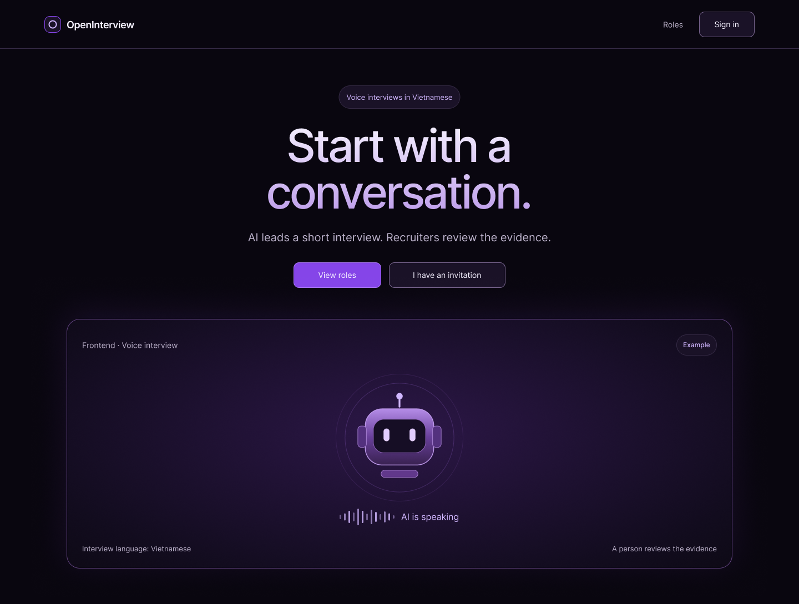

<h1 align="center">
    
</h1>

    

---
AI-powered voice interviews in Vietnamese, with people making the decisions.

OpenInterview aims to help recruiters run short preliminary interviews with an AI
voice agent. The planned agent listens to Vietnamese speech, asks HR-approved
questions, and answers from approved company information. After the interview,
AI will prepare an evidence-based summary for recruiters to review.
People make the hiring decisions, not the AI.

The voice pipeline is **STT → LLM → TTS**. A controller
checks the AI's proposed actions, question limits, and guardrails before it responds.

All website UI is in English. Interview speech is in Vietnamese.

## Current status

This is an early scaffold with a connected, opt-in candidate demo at `/roles`,
a FastAPI API, PostgreSQL, and an idle worker. The demo uses synthetic role
labels and temporary rooms/sessions, not real interviews or authentication.
Production authorization, interview media, and report jobs remain unimplemented.
See [candidate demo setup](docs/contributing/development.md#candidate-demo-no-cloud-services).

Google-only `/login` and `/signup` use the same-origin auth API. After private
OAuth/PostgreSQL setup and an explicit auth migration, run `npm run test:auth`
for the API and isolated frontend only (no voice worker).
Run `.venv/bin/python -m backend.auth migrate --env-file .env` explicitly first,
then `.venv/bin/python -m backend.auth check --env-file .env` to validate setup.
See [auth quickstart](docs/contributing/development.md#google-sign-in-and-sign-up)
and [Google auth setup](docs/contributing/google-auth.md). Real Google sign-in
requires your credentials; offline checks do not prove a live OAuth flow.

An opt-in [local voice conversation test](docs/contributing/development.md#opt-in-local-voice-conversation-test)
now provides restricted developer tokens and a named STT → LLM → TTS worker.
After one-time setup in that guide, `npm run test:voice` starts the API, named
worker and isolated `/local-voice` frontend in one terminal; Ctrl+C stops them.
It contacts cloud services and may cost money. This is not interview-controller
integration or production readiness.
Local pipeline evidence and two-sided replay are separately opt-in and require
specific recording consent; see the development guide. Capture is off by default.

## Stack

### AI and voice

Configured model choices are listed below. The full voice pipeline is not connected
yet; provider access checks do not prove interview quality or model availability.

| Component | Technology | Purpose |
| --- | --- | --- |
| Speech-to-text (STT) | Deepgram Nova-3, language `vi` | Turn Vietnamese speech into text |
| Interview LLM | Google Gemini, `gemini-3.5-flash-lite` | Propose questions and responses |
| Report LLM | Google Gemini, `gemini-3.8-flash` | Prepare summaries for human review |
| Text-to-speech (TTS) | ElevenLabs, `eleven_flash_v2_5` | Turn response text into speech |
| Voice transport and agent runtime | LiveKit Cloud and LiveKit Agents for Python | Connect browser audio to the agent |

Model IDs are backend configuration, not fixed product requirements. Voice selection,
Vietnamese quality, and plugin compatibility still need testing.

### Application

- Next.js App Router, TypeScript, and Tailwind CSS v4 for the website.
- Python and FastAPI for the API and worker scaffold.
- PostgreSQL and Docker Compose for the local stack.

## Explore and contribute

- [Get started](docs/contributing/getting-started.md) — local Docker setup.
- [Development guide](docs/contributing/development.md) — commands, checks, and limits.
- [Conventions](docs/contributing/conventions.md) — small changes and safe data handling.
- [Documentation](docs/README.md) — product, architecture, and planning.
- [Sprint plan](docs/planning/sprint-plan.md) — proposed work and acceptance gates.

---
