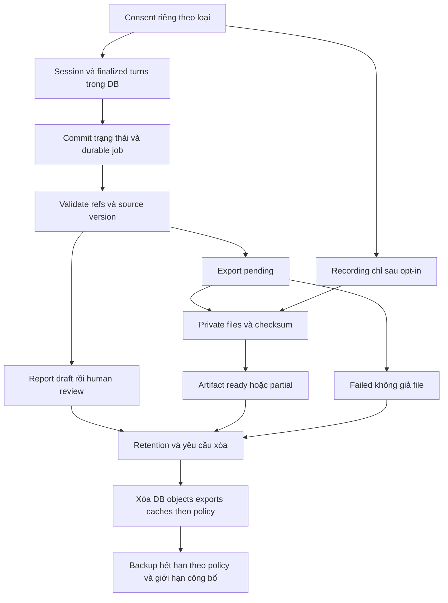

# Artifact và vòng đời dữ liệu phỏng vấn

Thiết kế đề xuất, chưa triển khai. Recording/export là future OUT OF SCOPE, không active MVP/UI/disabled controls; các ví dụ file/export/recording dưới đây chỉ là thiết kế tương lai, không backlog hiện hành. Đọc cùng [I/O contracts](io-contracts.md), [yêu cầu](../business/requirements.md) và [báo cáo](../report/interview-report.md). Ví dụ synthetic. Raw là STT finalized nguyên gốc, không partial/bản sửa tay hoặc bảo đảm ground truth. Website English; speech/transcript/evidence nguồn Vietnamese. UI đúng [7 trang desktop](../product/README.md), không candidate portal.

## Nguồn chuẩn và danh mục

PostgreSQL là nguồn chuẩn cho room, CVAttachment metadata, session, consent, turn, version, correction, job và report. Private object store BẮT BUỘC hiện tại để giữ HR room CV, không phụ thuộc recording/export. Quarantine/scanner và server-only credentials phải provision trước upload thật; không public URL/worker temp disk làm kho bền vững. Future export chỉ là dẫn xuất, không thay DB.

## Room CV — active MVP

Hợp đồng Room/CVAttachment là [đề xuất chung](../business/requirements.md#hợp-đồng-dữ-liệu-tối-thiểu), không migration đã có. HR có thể upload CV khi tạo room, không candidate upload/profile/library/per-career sharing/history/settings portal. User không bắt buộc CV: null / “No CV attached” cho phép publish/join nếu các cổng khác pass. Candidate không manage/download file mặc định; mismatch qua HR contact inline trước start.

Trước upload HR phải xác minh authority để upload/disclose và lawful basis/notice theo policy riêng. Không gán pre-session CV cho consent phỏng vấn chưa tồn tại, không dùng consent về sau hồi tố. Backend kiểm tra scope, exact candidate/room relationship và bounded PDF (extension/MIME/signature/size, 5 MB configurable proposal). File quarantine, `quarantined/scanning/available/rejected/scan_failed` là trạng thái đề xuất; chỉ scan thành công mới available. Không scanner/failed scan => không publish room có file, không chỉ cảnh báo client.

Publish/invite khóa candidate identity + campaign version + CV attachment ID/version/SHA-256/size hoặc explicit absence. HR sửa draft được; sai file sau publish phải revoke/cancel room cũ và tạo NEW room với attachment đã sửa, không overwrite/swap ongoing session/source history. Object keys opaque; metadata version/checksum immutable. CV chỉ HR reference, claims chưa xác minh; không parsing/scoring/prompt input. Report provenance có thể ghim room/CV ref/hash nhưng không cite CV thành finalized candidate turn. `candidate-profile.json` bên dưới là machine-derived fact/report artifact, KHÔNG candidate profile portal.

Fresh authorization cho mỗi signed private URL TTL ngắn, chỉ assigned HR/worker khi job cần, không candidate mặc định hoặc blanket Admin access. Revoke/delete chặn URL mới và xử lý URL còn sống theo TTL/platform limits công bố. Audit ID/action/time, không log URL/content/secrets. Retention riêng room/CV kể cả chưa có session, quarantine/rejected/orphan files và copies/backups; xóa DB metadata/object/cache/copies theo policy và legal hold. Backup expiration/restore phải áp tombstones; scan/report/retry jobs kiểm tra tombstone trước publish, không hồi sinh file. Không hứa instant backup deletion.

## File artifact catalogue — future OUT OF SCOPE

Các file/export/recording sau không thuộc active MVP; logic finalized transcript/correction/report vẫn áp dụng cho dữ liệu DB hiện hành. Không sinh UI hoặc task capture/export từ ví dụ này.

| Artifact đề xuất | Nội dung / format | Điều kiện và nguồn |
| --- | --- | --- |
| `manifest.json` | Schema, phiên giả danh, input/config versions, file status, checksum/size | Mỗi export; chỉ công bố ready sau khi kiểm tra file |
| `transcript.raw.jsonl` | Một finalized turn mỗi dòng; cả candidate và assistant confirmed text | Consent transcript; giữ nguyên final và provenance |
| `transcript.raw.txt` | Bản dễ đọc có role, turn ID, audio offsets và nhãn unknown/gap | Dẫn xuất từ raw, không sửa chính tả âm thầm |
| `transcript.reviewed.jsonl`, `transcript.reviewed.txt` | View tùy chọn áp correction; `corrections.jsonl` lưu original ref, thay đổi, người sửa, UTC/lý do | Không ghi đè raw; candidate tự sửa cũng là turn/correction có ref |
| `candidate-profile.json` | Machine-derived facts + collection status + evidence refs, KHÔNG portal | Tự khai, chưa xác minh; không yêu cầu CV từ candidate; tuổi tắt mặc định, không DOB/địa chỉ đầy đủ |
| `job-fit-summary.md`, `report.json` | Mô tả ngắn suitability, tiêu chí, thiếu dữ kiện, reviewer | Job bền vững từ finalized turns; không nhãn hire/reject hay điểm tuổi |
| `candidate-questions.json` | Candidate FAQ, turn, answer status/text đã xác nhận, source versions, recruiter followup | Chỉ bounded approved context; unknown/conflict/expired không tự điền |
| `events.jsonl` | Event ID/sequence/UTC/type, status và refs tối thiểu | Không token, secret, prompt hay nội dung PII đầy đủ |
| `assistant-generations.jsonl` | Planned text, generation ID và delivery result/confirmed turn ref | Tùy chọn nếu chính sách cho lưu; tách khỏi evidence, không đưa phần chưa phát vào canonical transcript |
| `recording/interview.wav`, `recording/metadata.json` | Hai phía cuộc gọi, WAV mono mix đề xuất và metadata gap/track/status | Chỉ khi opt-in audio riêng; separate tracks tùy nhu cầu/khả năng đã kiểm chứng |

Mỗi loại có retention/access riêng, không mặc định lưu mọi sản phẩm trung gian. Không đồng ý recording vẫn được phiên dựa transcript nếu có consent phù hợp cho phiên/transcript/report. Nếu không có consent bắt buộc của phiên thì không bắt đầu. Audio stream tạm không tự tạo recording.

## Cây export đề xuất — future OUT OF SCOPE

ID tenant/session là opaque, không tên/email/số điện thoại trong đường dẫn. Cây minh họa các file có thể có, không cam kết mọi phiên đều có đủ:

```text
tn_demo/ss_demo/export-v1/
  manifest.json
  transcript.raw.jsonl
  transcript.raw.txt
  transcript.reviewed.jsonl       # tùy chọn
  transcript.reviewed.txt         # tùy chọn
  corrections.jsonl              # tùy chọn
  candidate-profile.json
  job-fit-summary.md
  report.json
  candidate-questions.json
  events.jsonl
  assistant-generations.jsonl     # tùy chọn, không là evidence
  recording/                     # chỉ khi có recording
    interview.wav
    metadata.json
```

Registry/manifest dùng `empty` (không có dữ liệu), `pending`, `ready`, `partial`, `failed`; đây là artifact status, không thay job status trong tài liệu report. Loại không được bật không có file, khai báo lý do ở registry. Checksum SHA-256 và byte size bắt buộc cho file ready/partial thực sự tồn tại; pending/failed/empty không bịa URI/checksum. Snapshot đã xuất không tự đổi khi DB sửa: tạo source/export version mới và đánh dấu bản cũ superseded, vẫn áp retention/xóa.

Ví dụ manifest pending hợp lệ về hình dạng (chưa có file nên checksum/size null):

```json
{
  "schema_version": "1.0",
  "tenant_id": "tn_demo",
  "session_id": "ss_demo",
  "export_version": "export-v1",
  "source_version": "transcript-v1",
  "created_at": "2026-11-06T09:10:00Z",
  "provenance": {
    "campaign_version": "campaign-v2",
    "rubric_version": "rubric-v2",
    "faq_versions": ["faq-v1"],
    "stt_config_version": "stt-config-v1",
    "llm_model_config_version": "llm-config-v1",
    "tts_config_version": "tts-config-v1",
    "report_prompt_version": "report-prompt-v1"
  },
  "artifacts": [
    {"path": "transcript.raw.jsonl", "status": "pending", "size_bytes": null, "sha256": null}
  ],
  "recording_status": "disabled"
}
```

## Transcript, corrections và thông tin candidate

Ví dụ JSONL: assistant chỉ lưu phần được tracking xác nhận; text còn lại nằm ở generation riêng, không là lời đã nói. Offsets theo media timeline phiên (không UTC). Provenance chung lấy từ manifest/source snapshot, mỗi turn vẫn có source version.

```jsonl
{"schema_version":"1.0","session_id":"ss_demo","turn_id":"at_01","speaker":"assistant","finalized_text":"Bạn từng làm hỗ trợ khách hàng chưa?","delivery_status":"confirmed_delivered","audio_start_ms":0,"audio_end_ms":1800,"source_version":"transcript-v1","generation_id":"gen_01"}
{"schema_version":"1.0","session_id":"ss_demo","turn_id":"ct_01","speaker":"candidate","finalized_text":"Tôi đã trực tiếp xử lý yêu cầu hỗ trợ.","audio_start_ms":2000,"audio_end_ms":5000,"source_version":"transcript-v1","stt_revision":1}
```

```text
[00:00.000–00:01.800] assistant (at_01, confirmed_delivered): Bạn từng làm hỗ trợ khách hàng chưa?
[00:02.000–00:05.000] candidate (ct_01, STT final): Tôi đã trực tiếp xử lý yêu cầu hỗ trợ.
```

Nếu bị ngắt giữa câu, canonical turn chỉ có đoạn text map chắc tới playback đã xác nhận, delivery partial; không map được thì không tạo text evidence và ghi unknown trong delivery metadata/events. Không lấy planned text đưa vào raw.txt như lời đã nói. Confirmed delivery chỉ là bằng chứng kỹ thuật best-effort, không chứng minh candidate nghe/hiểu. Gap không được điền bằng text suy đoán.

Ví dụ correction của reviewer sửa lỗi STT giả định, và profile dùng bằng chứng final hiện có:

```jsonl
{"schema_version":"1.0","correction_id":"corr_01","session_id":"ss_demo","target_turn_id":"ct_01","source_version":"transcript-v1","reviewed_version":"transcript-v2","replacement_text":"Tôi đã trực tiếp xử lý yêu cầu hỗ trợ khách hàng.","reason":"Đối chiếu và xác nhận lại với candidate","reviewer_id":"rv_demo","created_at":"2026-11-06T09:12:00Z"}
```

```json
{
  "schema_version": "1.0",
  "session_id": "ss_demo",
  "source_version": "transcript-v1",
  "verification_status": "self_reported_unverified",
  "facts": [
    {"field":"support_experience","value":"Từng trực tiếp xử lý yêu cầu hỗ trợ","collection_status":"supported","evidence_turn_ids":["ct_01"]},
    {"field":"availability","value":null,"collection_status":"not_collected","evidence_turn_ids":[]}
  ]
}
```

`supported` chỉ là có lời khai hỗ trợ fact, không xác minh kinh nghiệm ngoài đời. Dùng `refused` hoặc `insufficient_evidence` khi phù hợp; null không thành chuỗi rỗng hay giá trị mặc định. Correction mới làm report input version mới và cần duyệt lại, không tự sửa report đã duyệt.

## Báo cáo suitability và FAQ

Ví dụ future `job-fit-summary.md`: “The candidate reports handling support requests (ct_01), partly supporting the support experience criterion. A detailed example and availability have not been collected. Recruiter verification is needed; this is not a hiring decision.” App-generated summary English, original transcript Vietnamese; không nâng tự khai thành năng lực đã kiểm chứng.

```json
{
  "schema_version": "1.0",
  "session_id": "ss_demo",
  "input_version": "transcript-v1",
  "rubric_version": "rubric-v2",
  "status": "draft",
  "summary": "Self-reported support experience; a detailed example and availability are missing.",
  "criteria": [
    {"criterion_id":"experience.customer_support","requirement_status":"partial","evidence_status":"supported","evidence_turn_ids":["ct_01"],"note":"Self-reported, unverified"},
    {"criterion_id":"availability","requirement_status":"missing","evidence_status":"not_collected","evidence_turn_ids":[],"note":"Not asked; not low ability"}
  ],
  "reviewer": {"id":null,"reviewed_at":null}
}
```

`requirement_status` là `fulfilled`/`partial`/`missing` về mức đáp ứng được chứng minh theo rubric, không phải hire/reject. Missing phải kèm evidence status để phân biệt chưa hỏi, từ chối, không đủ bằng chứng và thiếu đáp ứng có căn cứ. Unknown/refused không là đánh giá năng lực âm. Validate mọi evidence ref tồn tại, đúng phiên và là finalized candidate turn; câu hỏi đã hỏi đối chiếu assistant delivery riêng. Reviewer ghi ID/thời điểm khi duyệt, không dùng tên giả làm người duyệt thật.

```json
{
  "schema_version": "1.0",
  "session_id": "ss_demo",
  "questions": [
    {"question_id":"cq_01","turn_id":"ct_02","text":"Có làm cuối tuần không?","answer_status":"unknown","confirmed_answer_text":null,"source_versions":[],"followup_status":"pending_recruiter"}
  ]
}
```

FAQ trên là ví dụ độc lập: chỉ xuất entry sau khi turn `ct_02` có trong snapshot thực tế. Không có nguồn được duyệt thì unknown; không suy đoán chính sách. Khi answered phải giữ source ID/version và hiệu lực tại lúc trả lời; câu trả lời planned chưa phát không thành confirmed answer.

## Recording hai phía — future OUT OF SCOPE, chỉ opt-in riêng nếu duyệt sau

Audio off mặc định. Chỉ bắt đầu capture sau consent recording rõ ràng, riêng với consent transcript/report; không lưu preconsent audio hoặc buffer trước consent vào file. Đề xuất tích hợp LiveKit recording/egress để thu hai phía, phải kiểm chứng deployed plan, quyền, SDK, track và consent gate. Không giả định ghi mic agent sẽ bắt được remote playback hoàn hảo. Mix hai phía là baseline xuất tùy chọn; separate tracks chỉ khi khả năng/lý do được xác minh, kèm speaker mapping. Không coi silence là không có dropout.

`recording_status`: `absent` (chưa có yêu cầu/metadata), `disabled` (không opt-in hoặc cấu hình tắt), `recording`, `complete`, `partial`, `failed`. Failed không có file thì path null; partial chỉ trỏ file thật, nêu đoạn thiếu. Complete chỉ nghĩa capture hoàn tất trong khoảng đã công bố, không bảo đảm chất lượng/đủ toàn phiên. Rút consent dừng capture tương lai; không âm thầm khởi động lại khi reconnect. Xử lý phần đã thu theo chính sách đã công bố và nghĩa vụ áp dụng, không hứa xóa vô điều kiện.

Ví dụ metadata lỗi không có file (không có WAV minh họa thật):

```json
{
  "schema_version": "1.0",
  "session_id": "ss_demo",
  "recording_status": "failed",
  "consent_record_id": "consent_audio_demo",
  "consented_at": "2026-11-06T09:00:00Z",
  "capture_started_at": null,
  "capture_ended_at": null,
  "session_offset_start_ms": null,
  "path": null,
  "format": null,
  "tracks": [],
  "gaps": [],
  "error_code": "egress_start_failed"
}
```

Khi file tồn tại, metadata phải ghi path, byte size/checksum (hoặc ref registry), format `WAV/PCM`, bits/sample, channels, sample rate thật; UTC start/end, session offset bắt đầu, track IDs/role và mixed/separate. Mỗi gap có session start/end ms, lý do/unknown, và cách mapping file offsets (giữ silence hay timeline bị nén). Ghi việc bắt đầu muộn, dropout, dừng do withdrawal và recording failure; không khẳng định file dài bằng toàn phiên. Retention áp cả track gốc và mix/export.

## Vòng đời file artifact tương lai — OUT OF SCOPE



Persist DB trước, sau đó job report/export idempotent theo `(session_id, input_version, artifact_kind, export_config_version)`; lease/unique key theo [report jobs](../report/interview-report.md). Upload file thành công chưa có nghĩa ready: xác minh size/checksum rồi commit registry. Retry dùng lại logical artifact, không tạo hai bản hiệu lực; file mồ côi do crash cần đối soát/xóa theo policy. Không cần queue dịch vụ mới. Job không được hồi sinh dữ liệu đã bị đánh dấu xóa; kiểm tra trạng thái/consent/source version trước publish.

| Vai trò | Đọc/xuất | Sửa/duyệt/xóa |
| --- | --- | --- |
| Candidate | Chỉ phiên của mình qua scoped link nếu sản phẩm cung cấp; không mặc định có portal/download | Yêu cầu sửa/xóa theo quy trình, không sửa raw trực tiếp |
| Recruiter | Chỉ campaign/session được phân quyền; audio cần quyền riêng phù hợp | Correction/duyệt theo quyền; xóa theo chính sách tổ chức |
| Admin/operator | Metadata vận hành tối thiểu; không tự có quyền xem toàn bộ nội dung | Quyền đặc biệt có lý do, cấp rõ và audit; không bypass tenant |
| Worker | Chỉ source/artifact cần cho job của phiên | Tạo version theo job, không cấp quyền tải công khai |

Download phải auth/authorize tenant + session + artifact mỗi lần cấp private signed URL TTL ngắn. URL hết hạn có thể cấp lại sau kiểm tra quyền; stable artifact ID không phải public URL vĩnh viễn. Thu hồi/xóa phải chặn cấp mới và xử lý URL còn sống theo khả năng nền tảng/TTL đã công bố. Mã hóa khi truyền và at rest cấu hình/kiểm chứng theo nền tảng, không tự tuyên bố E2EE. Audit ai xem/tải/sửa/duyệt/xóa bằng ID, không log signed URL, secret hay nội dung PII đầy đủ.

Retention cấu hình riêng transcript, corrections, profile, report, events, audio và exports; công bố trước thu dữ liệu, không áp số ngày tùy tiện. Xóa gồm DB/source dẫn xuất, object/track/mix, exports, caches và provider copies trong phạm vi chính sách/hợp đồng; backup theo thời hạn/giới hạn đã công bố, không hứa xóa tức thời khỏi backup. Khi restore phải áp lại tombstone/yêu cầu xóa để không hồi sinh dữ liệu. Legal hold/nghĩa vụ áp dụng và bằng chứng consent tối thiểu cần chủ sở hữu chốt; không mặc định giữ report vô hạn sau khi xóa audio.

## Checklist artifact tương lai — OUT OF SCOPE active MVP

- [ ] Không consent phiên thì không bắt đầu; không audio opt-in thì không recording/object audio, không preconsent capture; quyền mic không thay consent.
- [ ] Rút recording consent dừng capture tương lai, reconnect/retry không tự bật lại; từ chối audio vẫn cho phiên transcript đã consent riêng.
- [ ] Raw giữ STT finalized của candidate và text assistant được tracking xác nhận đã phát; partial STT bị loại, correction tách riêng, reviewed view có provenance; dữ liệu rỗng/thiếu có status/null rõ.
- [ ] Interruption không biến planned/queued text thành spoken; unknown delivery không dùng evidence. Gap/start muộn/dropout có mapping, không bịa file khi failure.
- [ ] JSON/JSONL parse được, schema/version và stable artifact refs đầy đủ; ready/partial file có size/checksum thực, download URL không coi là stable ID.
- [ ] Report refs trỏ finalized candidate turns hiện có đúng snapshot/phiên; FAQ refs cũng tồn tại; unknown/refused không bị phạt, reviewer và self-report được ghi rõ.
- [ ] Download trái tenant/campaign/session bị từ chối, URL hết hạn không truy cập được; cấp lại vẫn kiểm tra quyền.
- [ ] Crash/retry job không nhân đôi artifact/report hiệu lực, đối soát object mồ côi, source sửa tạo version mới cần duyệt lại.
- [ ] Retention/xóa bao trùm DB, objects, track, exports/cache và giới hạn backup; job/restore không hồi sinh dữ liệu đã xóa.

Còn phải chốt cho MVP: schema/limits, scan service, HR lawful basis/notice owner, CV retention/backups, consent phiên, provider region/retention và playback tracking thật. Recording egress, candidate artifact download và codec/export configuration chỉ là future OUT OF SCOPE. Đây không phải kết quả test ứng dụng.
