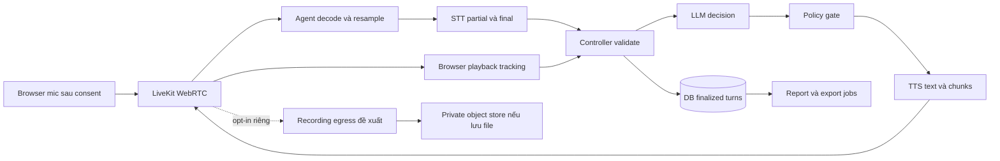

# Hợp đồng đầu vào và đầu ra

Đây là hợp đồng logic đề xuất cho MVP, chưa phải API, schema DB hay tính năng đã triển khai. Áp dụng [yêu cầu nghiệp vụ](../business/requirements.md), [điều phối](conversation-workflow.md) và [quy tắc artifact](data-artifacts.md). Không yêu cầu CV, không PSTN; quyết định tuyển dụng thuộc con người.

## Ranh giới dữ liệu

| Dữ liệu | Producer → consumer | Định dạng và mức cần thiết | Kiểm tra | Vòng đời |
| --- | --- | --- | --- | --- |
| Giọng candidate | Mic browser → LiveKit → Python agent/STT | Media WebRTC; bắt buộc cho voice session | Consent trước thu nội dung, quyền mic, track đúng identity/room, codec và mức âm phù hợp | Buffer tạm; streaming không có nghĩa đã lưu audio |
| Ngôn ngữ | Candidate/UI → controller/STT/TTS | Language tag, mặc định đề xuất `vi`; cần cho cấu hình phiên | Chỉ chọn ngôn ngữ provider đã kiểm chứng; không suy ra quốc tịch | Cấu hình phiên được lưu |
| Consent | Candidate → backend/controller | Lựa chọn transcript/phiên, recording, report theo chính sách riêng; phiên bản thông báo và UTC | Không coi quyền mic là informed consent; không chọn sẵn recording; kiểm tra lại khi rút consent | Lưu bằng chứng lựa chọn tối thiểu theo chính sách |
| Metadata phiên | Backend → browser/worker | Opaque tenant/session/campaign IDs, identity scoped, UTC, version; bắt buộc | Auth và quyền tenant/campaign/session; token TTL ngắn, không log token | State/version lưu DB; credential tạm |
| JD và yêu cầu tuyển | Recruiter → backend/bộ sinh câu hỏi | Text có giới hạn kích thước; bắt buộc | Quyền sửa, không rỗng, coi nội dung là dữ liệu không tin cậy | Snapshot có version |
| Câu hỏi lõi/rubric | Recruiter phê duyệt → controller/report | Structured question/criterion IDs, giới hạn followup; bắt buộc | Chặn phiên chưa duyệt; khóa version, không đổi hồi tố | DB nguồn chuẩn |
| FAQ nội bộ | Recruiter → controller/LLM | Context nhỏ có source ID/version, hiệu lực, approval; tùy chọn | Giới hạn kích thước, quyền truy cập, chỉ nguồn duyệt còn hiệu lực; thiếu thì unknown | Snapshot/version được lưu; prompt tạm |
| Thông tin và FAQ candidate | Candidate finalized turns → facts/FAQ/report | Text + collection status + turn refs; trường theo chiến dịch | Không tự điền; tuổi chỉ khi có lý do/consent/pháp lý; không DOB/địa chỉ đầy đủ | Lưu tối thiểu theo consent |
| Lệnh skip/clarify/end/interrupt | Candidate/UI hoặc voice → controller | Control event hoặc ý định đã xác nhận | Thuộc phiên, action allowlist, hạn mức; end không bị bỏ qua vì hết quota | State và sự kiện tối thiểu |

Nội dung candidate/JD không được thay policy, rubric hoặc mở quyền công cụ. Cấu hình provider/region, giới hạn payload và thời hạn token phải chốt trước triển khai; không đưa credential vào hợp đồng xuất.

## Sản phẩm trung gian và đầu ra

| Sản phẩm | Producer → consumer | Hình dạng / bắt buộc | Kiểm tra và lưu trữ |
| --- | --- | --- | --- |
| STT partial | STT → UI/controller | Hypothesis có revision; tùy chọn | Tạm thời, không là evidence, không ghi vào raw transcript |
| STT final | STT → controller/DB | Finalized text + turn ID + audio offsets; cần cho turn candidate | Validate phiên/sequence; giữ nguyên bản final, correction tách riêng; không khẳng định đúng nguyên văn tuyệt đối |
| LLM decision | LLM → controller | Action/criterion/evidence/question có cấu trúc | Controller validate schema, refs, deadline và hạn mức như tài liệu điều phối; không lưu chain-of-thought |
| Text TTS | Controller → TTS | Text đã được policy cho phép + generation ID | Planned text là diagnostic riêng, không phải assistant evidence; hủy generation cũ khi ngắt |
| Audio chunks | TTS → agent → LiveKit → browser | Chunk có generation/sequence, format provider | Buffer hữu hạn; queued khác delivered; chunk bị hủy không được phát lại |
| Audio trả candidate | LiveKit → browser | Voice response; đầu ra chính | Theo dõi playback best-effort; không chứng minh con người thực sự nghe; delivery unknown không tính đã hỏi |
| Captions/status | Controller → browser | Tùy chọn: partial/final, đang xử lý, lỗi, reconnect | Gắn nhãn partial/planned, không hiển thị nhầm là lời đã phát; không hứa text fallback nếu chưa triển khai |
| Report/evidence | DB + report worker → recruiter | Summary, criterion status, finalized turn refs, reviewer | Theo [báo cáo](../report/interview-report.md); không tự tuyển/loại; persist trước khi báo ready |
| Export/recording | Artifact job → người có quyền | Manifest/files; tùy chọn | Theo [artifact](data-artifacts.md); recording cần opt-in riêng, không có file giả khi lỗi |

Browser thường thương lượng Opus trên WebRTC. Agent decode/resample sang PCM theo yêu cầu provider thực tế, không áp một chuẩn 16 kHz cho mọi chặng. TTS có thể dùng format khác rồi chuyển phù hợp track xuất. Recording xuất đề xuất WAV mono 16-bit PCM, sample rate 16/24/48 kHz theo cấu hình thương lượng/xuất; metadata phải ghi giá trị thật. Mono mix không thay được separate tracks khi cần phân biệt người nói.



## Ví dụ event/turn logic

Mọi ví dụ trong hai tài liệu mới là synthetic, không phải dữ liệu phỏng vấn thật. Envelope đề xuất dưới đây biểu diễn một candidate final; không phải endpoint đã có:

```json
{
  "schema_version": "1.0",
  "event_id": "ev_03",
  "event_type": "candidate_turn_finalized",
  "tenant_id": "tn_demo",
  "session_id": "ss_demo",
  "sequence": 3,
  "occurred_at": "2026-11-06T09:00:05Z",
  "turn": {
    "turn_id": "ct_01",
    "speaker": "candidate",
    "kind": "answer",
    "finalized_text": "Tôi đã trực tiếp xử lý yêu cầu hỗ trợ.",
    "audio_start_ms": 2000,
    "audio_end_ms": 5000,
    "stt_revision": 1,
    "source_version": "transcript-v1"
  },
  "provenance": {
    "campaign_version": "campaign-v2",
    "rubric_version": "rubric-v2",
    "stt_config_version": "stt-config-v1"
  }
}
```

`occurred_at` là UTC để audit; audio offsets là ms từ media timeline bắt đầu phiên, không phải epoch hay vị trí byte WAV. Khi reconnect giữ timeline và ghi gap; mapping recording timeline riêng trong metadata. Không dùng thời điểm nhận event thay timestamp audio. Turn ID ổn định cho cùng final; revision/correction có nguồn gốc rõ, không ghi đè mất lịch sử.

Assistant giữ `planned_text` ở sản phẩm generation riêng. Canonical Turn chỉ có phần `finalized_text` xác nhận đã phát, `delivery_status` và offsets tương ứng. Nếu tracking chỉ chứng minh delivered media mà không map chắc text, giữ unknown và không suy đoán prefix từ tỷ lệ thời lượng. Generated → queued → confirmed delivered/partial/unknown là các trạng thái khác nhau; không đồng nghĩa thực sự đã nghe.

## Thứ tự, lỗi và phục hồi MVP

- Backend/controller là nơi cấp sequence logic theo phiên; media chunk sequence riêng theo generation. Dedupe event theo `(session_id, event_id)` và final theo turn/revision bằng unique key DB. Persist turn + state trong transaction trước khi job report/export tham chiếu nó; không cần Kafka/Redis.
- Reconnect xác thực lại đúng phiên, đối soát sequence/turn đã commit và pending generation. Không blind replay lời hỏi hoặc tạo turn mới vì retry. Event trễ của generation đã hủy bị loại; event ngoài thứ tự chờ đối soát hữu hạn hoặc đánh dấu gap, không âm thầm đảo lịch sử.
- Echo/noise: dùng khả năng echo cancellation/browser và VAD phù hợp, kiểm chứng thực tế; không nhận audio assistant vọng lại thành câu trả lời candidate. Barge-in hủy LLM/TTS, dừng/xóa queue và ghi phần delivery đã xác nhận; phần còn lại unknown/cancelled.
- Timeout/provider lỗi: retry hữu hạn theo cấu hình, báo trạng thái ngắn nếu media còn hoạt động; hết hạn thì kết thúc gián đoạn có lý do. Không bịa transcript/answer. Mic bị chặn thì hướng dẫn thử lại hoặc dừng, không lách consent.
- Backpressure: queue media hữu hạn, giới hạn generation đang hoạt động; ngừng sản xuất/hủy output stale khi consumer chậm. Không âm thầm bỏ candidate audio: ghi gap/partial và hỏi lại khi có thể. Ngưỡng queue/timeout phải đo trước khi chốt, không là SLA.
- Text fallback chỉ là quyết định tùy chọn sau này; MVP không mặc định có kênh trả lời thay voice. Quy tắc consent và provenance vẫn áp dụng nếu bổ sung.
