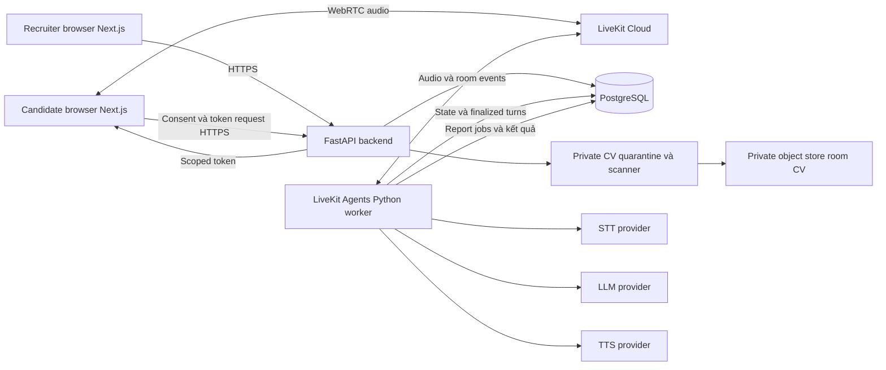

# Kiến trúc và công nghệ đề xuất

Chi tiết dữ liệu tại [hợp đồng I/O](io-contracts.md) và [artifact/room CV storage](data-artifacts.md); các hợp đồng này vẫn là thiết kế đề xuất. Desktop only, đúng [7 page types](../product/README.md), không thêm service theo số màn hình. Recording/export ngoài active MVP.

## Thành phần tối thiểu

Một backend ứng dụng và một agent worker dài hạn; có thể chung repository/deployment nhưng worker không chạy như hàm serverless ngắn hạn. Managed LiveKit vận chuyển media; PostgreSQL lưu trạng thái và job. Không cần Kubernetes, microservices, Redis, Kafka hay LangGraph cho MVP. Worker có thể poll job DB để dựng báo cáo; xem [cơ chế bền vững](../report/interview-report.md).

## Stack và điều kiện lựa chọn

| Thành phần | Baseline | Phải xác minh trước demo |
| --- | --- | --- |
| UI | Next.js | HTTPS, quyền mic, playback/autoplay và browser mục tiêu |
| API | FastAPI | Auth, consent, campaign version, token scoped, quyền truy cập |
| Media/agent | LiveKit Cloud + Agents Python | SDK/plugin tương thích phiên bản; interruption và delivery tracking |
| STT | Deepgram Nova-3, `vi` | Hỗ trợ tiếng Việt hiện tại, streaming, vùng giọng và code switching |
| LLM | Gemini Flash hiện được hỗ trợ | Model ID/region/quota/plugin hiện hành; chỉ dùng 2.5 Flash nếu còn khả dụng |
| TTS | ElevenLabs `eleven_flash_v2_5`, voice tiếng Việt | Model/voice thực sự hỗ trợ tiếng Việt, phát âm tên riêng và streaming |
| Lưu trữ | PostgreSQL | Transaction, unique key job/report, backup, retention và quyền |
| Room CV | Private object store + server validation/scanner | Bắt buộc cho CV retained: bounded PDF 5 MB configurable proposal, quarantine/scan trước publish, immutable checksum/version, scoped HR/worker URLs, retention/xóa/backups |

Tên model là cấu hình backend, không hardcode vào yêu cầu nghiệp vụ. Chưa xác minh availability, giá hoặc compatibility trực tiếp với provider trong tài liệu này. Gemini Live chỉ là lựa chọn so sánh tương lai, không thuộc pipeline STT → LLM → TTS đã chọn.

## Ranh giới tin cậy và vận hành

- Backend xác thực phiên mời trước khi cấp token LiveKit TTL ngắn; ràng buộc room, identity, publish/subscribe cần thiết. Không cấp quyền quản trị cho browser; kiểm tra lại khi xin token mới.
- Credential provider chỉ ở secret phía server/worker. HTTPS cho API; cấu hình media encryption theo LiveKit và đánh giá riêng nếu cần E2EE, không mặc định tuyên bố E2EE toàn pipeline.
- Worker chỉ nhận campaign snapshot được duyệt và dữ liệu đúng phiên. Speech/document của candidate là dữ liệu không tin cậy; không có quyền thay system policy, rubric hoặc truy cập công cụ nội bộ.
- Context FAQ nhỏ được nạp trực tiếp vào prompt; giới hạn kích thước và chỉ chọn nguồn đã duyệt. Không vector DB, không agent web search chính sách.
- Phân quyền đọc transcript/report/room CV; audit xem/sửa/duyệt/xóa, retention riêng và copies/backups theo policy; tombstone ngăn job/restore hồi sinh. Recording/export ngoài active MVP.
- Room binds exact candidate identity + campaign version + optional CV ID/version/hash hoặc absence khi publish/invite. Backend xác minh relationship, HR authority/lawful basis/notice trước upload, server scan trước publish; không scan không publish room có file. Draft sửa được; sau publish sai CV phải revoke/cancel và tạo room mới, không swap source phiên. Không candidate profile/CV portal hay default candidate download. File URLs chỉ assigned HR/worker khi cần sau fresh auth, TTL ngắn; không parse/score/nạp CV vào AI prompt.
- Interview chỉ stage + ba controls mic/speaker/End, status/error ngắn trong stage. Deadline/connection/delivery vẫn backend, không timer UI. End dừng media/cancel ngay, persist terminal state + durable report job idempotently và về Roles; offline stop local rồi đối soát terminal/stale session, không tự resume audio.
- Theo dõi trạng thái room/worker, timeout, quota, job backlog và lỗi provider với session ID giả danh; tránh log nội dung cá nhân và token. Dữ liệu demo nên là synthetic.

## Hiệu năng cần đo, không phải SLA

Mục tiêu chưa đo: p50 0,8–1,5 giây, p95 khoảng 2,5 giây từ lúc candidate kết thúc lời nói thực tế đến lúc nghe được âm thanh trả lời đầu tiên. Chỉ đánh giá trong cấu hình browser, mạng, vùng provider, tải đồng thời và độ dài context đã ghi nhận. Bao gồm endpointing, STT finalize, LLM first output, TTS và buffering/playback; không chỉ đo API LLM.

Ghi timestamp tại từng chặng và quan sát playback phía client. VAD phát hiện hoạt động tiếng nói, không hiểu câu đã hết ý; cần kiểm chứng endpointing tiếng Việt và khoảng ngập ngừng. Đo thêm cắt lời sai, thời gian dừng khi barge-in, STT sai tên/số/phủ định, độ bám nguồn FAQ, tỷ lệ lỗi và chi phí thực/call. Không có benchmark hoặc cam kết chi phí trong bản thiết kế.
