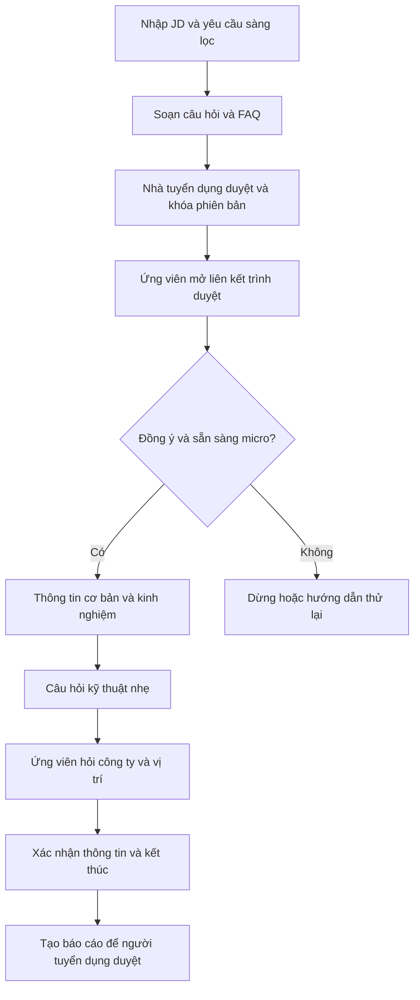

# Tổng quan nghiệp vụ

## Mục tiêu

OpenInterview hỗ trợ nhà tuyển dụng thực hiện bước trao đổi sơ bộ bằng giọng nói tiếng Việt trên trình duyệt. AI hỏi các câu cơ bản nhất quán, ghi nhận câu trả lời và tạo bản tóm tắt để con người xem xét. Sản phẩm không thay thế người ra quyết định và không bảo đảm đánh giá đúng năng lực chỉ từ một cuộc nói chuyện ngắn.

Nhà tuyển dụng cung cấp JD, yêu cầu sàng lọc và thông tin đã duyệt. Không yêu cầu CV từ candidate. HR có thể upload CV khi tạo room; thiếu file là “No CV attached”, không chặn eligibility. CV chỉ là HR reference, không parse/score/nạp AI prompt. Nhà tuyển dụng duyệt câu hỏi/rubric/FAQ và khóa version trước phiên; câu hỏi lõi và tiêu chí chung cho chiến dịch.

Desktop only, đúng [7 trang](../product/README.md): Home, Sign in, Roles, Join room, Interview, HR, Admin. Home chỉ navbar, hero hai CTA và robot preview Example. Interview chỉ stage + đúng ba controls mic/speaker/End; End trực tiếp trả Roles với “Interview ended”, không ép wrap hoặc hứa xóa. Consent/mic/speaker/waiting chung Join room. Không candidate profile/history/CV portal. Website English, speech Vietnamese.

Publish/invite khóa exact candidate identity + campaign version + CV ID/version/hash hoặc absence của room. HR sửa draft được; sai CV sau publish phải revoke/cancel room cũ và tạo NEW room, không swap ongoing source history. HR xác minh authority/lawful basis/notice trước upload, không dùng consent phiên về sau để hợp thức hóa. Server validation/quarantine/scan và private object store bắt buộc cho CV retained; không scan không publish room có file. Xem [hợp đồng](requirements.md).

## Ai làm gì?

| Vai trò | Trách nhiệm |
| --- | --- |
| Nhà tuyển dụng | Chuẩn bị JD, tiêu chí, câu hỏi và thông tin trả lời ứng viên; duyệt báo cáo |
| Ứng viên | Đồng ý hoặc từ chối tham gia, trả lời, bỏ qua, sửa thông tin, hỏi lại hoặc kết thúc |
| Người vận hành | Quản lý quyền truy cập, cấu hình dịch vụ, thời hạn lưu và xử lý sự cố |

## Một cuộc trao đổi điển hình

Phiên dự kiến có ngân sách cấu hình, ví dụ 8–12 phút, không phải cam kết thời lượng cố định. AI hỏi từng câu, tối đa 1–2 câu đào sâu mỗi chủ đề. Hỏi lại vì nghe nhầm không được coi là bằng chứng ứng viên yếu. Khi hết thời gian, phần chưa hỏi được ghi rõ là chưa thu thập.

Thông tin thường hỏi gồm tên ứng viên tự cung cấp, học vấn/tốt nghiệp, kinh nghiệm, khu vực làm việc và khả năng đi làm. Không phải tất cả đều bắt buộc; ứng viên được từ chối. Không cần ngày sinh hoặc địa chỉ chính xác. Tuổi chỉ được bật khi có lý do phù hợp, được đồng ý và đáp ứng pháp luật; không dùng tuổi để chấm điểm.

## AI được và không được làm

- Được hỏi kỹ thuật tổng quát liên quan JD; không thi chuyên sâu hoặc kiểm tra lập trình.
- Được trả lời lương, phúc lợi, nơi làm việc, lịch làm và quy trình nếu có nguồn đã duyệt còn hiệu lực.
- Khi không biết, nguồn mâu thuẫn hoặc hết hạn, phải nói rõ chưa xác nhận và ghi việc cần nhà tuyển dụng trả lời; không hứa thay công ty.
- Không tự tìm chính sách trên mạng, không truy cập rộng dữ liệu nội bộ và không làm theo yêu cầu ứng viên nhằm đổi tiêu chí đánh giá.
- Không tự loại, xếp quyết định tuyển hay suy đoán thông tin ứng viên chưa nói.

## Dữ liệu và giá trị kỳ vọng

Recording/export ngoài active MVP, không có controls. Transcript/report cần consent phiên và retention công bố; room CV có căn cứ HR riêng trước upload và quyền/retention riêng. Demo ưu tiên synthetic. Candidate yêu cầu sửa/xóa qua contact inline, không profile/CV portal. Xóa gồm copies/backups theo policy; tombstone ngăn job/restore hồi sinh, không hứa xóa tức thời.

Giá trị cần kiểm chứng là giảm thao tác hỏi lặp lại, giúp người tuyển dụng thấy bằng chứng rõ hơn và giữ câu hỏi nhất quán. Chưa có số liệu chứng minh tiết kiệm bao nhiêu thời gian/chi phí. Xem [kế hoạch kiểm chứng](../planning/validation-plan.md) trước khi quyết định dùng thật.
