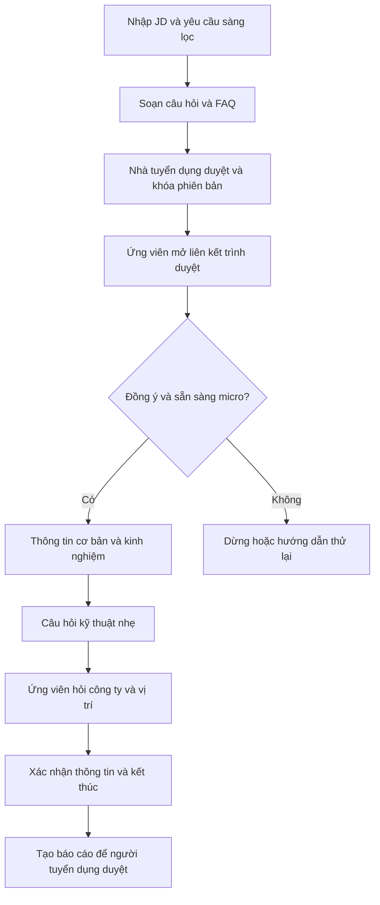

# Tổng quan nghiệp vụ

## Mục tiêu

OpenInterview hỗ trợ nhà tuyển dụng thực hiện bước trao đổi sơ bộ bằng giọng nói tiếng Việt trên trình duyệt. AI hỏi các câu cơ bản nhất quán, ghi nhận câu trả lời và tạo bản tóm tắt để con người xem xét. Sản phẩm không thay thế người ra quyết định và không bảo đảm đánh giá đúng năng lực chỉ từ một cuộc nói chuyện ngắn.

Nhà tuyển dụng cung cấp mô tả công việc (JD), yêu cầu sàng lọc và thông tin công ty/vị trí đã được phê duyệt. Không yêu cầu CV. Trước khi nhận ứng viên, hệ thống đề xuất bộ câu hỏi chung; nhà tuyển dụng chỉnh sửa, duyệt rồi khóa phiên bản. Các ứng viên cùng chiến dịch nhận cùng câu hỏi lõi và tiêu chí đánh giá, dù câu hỏi làm rõ có thể khác nhau.

## Ai làm gì?

| Vai trò | Trách nhiệm |
| --- | --- |
| Nhà tuyển dụng | Chuẩn bị JD, tiêu chí, câu hỏi và thông tin trả lời ứng viên; duyệt báo cáo |
| Ứng viên | Đồng ý hoặc từ chối tham gia, trả lời, bỏ qua, sửa thông tin, hỏi lại hoặc kết thúc |
| Người vận hành | Quản lý quyền truy cập, cấu hình dịch vụ, thời hạn lưu và xử lý sự cố |

## Một cuộc trao đổi điển hình

Phiên dự kiến có ngân sách cấu hình, ví dụ 8–12 phút, không phải cam kết thời lượng cố định. AI hỏi từng câu, tối đa 1–2 câu đào sâu mỗi chủ đề. Hỏi lại vì nghe nhầm không được coi là bằng chứng ứng viên yếu. Khi hết thời gian, phần chưa hỏi được ghi rõ là chưa thu thập.

Thông tin thường hỏi gồm tên ứng viên tự cung cấp, học vấn/tốt nghiệp, kinh nghiệm, khu vực làm việc và khả năng đi làm. Không phải tất cả đều bắt buộc; ứng viên được từ chối. Không cần ngày sinh hoặc địa chỉ chính xác. Tuổi chỉ được bật khi có lý do phù hợp, được đồng ý và đáp ứng pháp luật; không dùng tuổi để chấm điểm.

## AI được và không được làm

- Được hỏi kỹ thuật tổng quát liên quan JD; không thi chuyên sâu hoặc kiểm tra lập trình.
- Được trả lời lương, phúc lợi, nơi làm việc, lịch làm và quy trình nếu có nguồn đã duyệt còn hiệu lực.
- Khi không biết, nguồn mâu thuẫn hoặc hết hạn, phải nói rõ chưa xác nhận và ghi việc cần nhà tuyển dụng trả lời; không hứa thay công ty.
- Không tự tìm chính sách trên mạng, không truy cập rộng dữ liệu nội bộ và không làm theo yêu cầu ứng viên nhằm đổi tiêu chí đánh giá.
- Không tự loại, xếp quyết định tuyển hay suy đoán thông tin ứng viên chưa nói.

## Dữ liệu và giá trị kỳ vọng

Mặc định không ghi âm; ghi âm cần lựa chọn đồng ý riêng. Bản chép lời và báo cáo cũng cần thông báo mục đích, người được xem và thời hạn lưu cấu hình. Demo ưu tiên dữ liệu giả lập. Ứng viên có thể yêu cầu sửa thông tin theo quy trình được công bố.

Giá trị cần kiểm chứng là giảm thao tác hỏi lặp lại, giúp người tuyển dụng thấy bằng chứng rõ hơn và giữ câu hỏi nhất quán. Chưa có số liệu chứng minh tiết kiệm bao nhiêu thời gian/chi phí. Xem [kế hoạch kiểm chứng](../planning/validation-plan.md) trước khi quyết định dùng thật.
